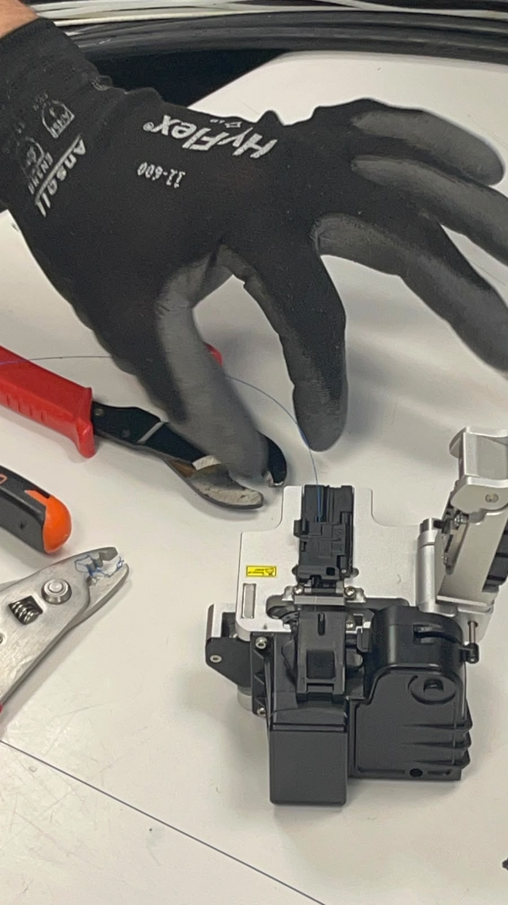

# 🔬 Manual Técnico: Fusión de Fibra Óptica

### 📡 Preparación, corte, empalme y protección de fibra óptica

**🏫 Institución:** INACAP La Serena  
**🎓 Carrera:** Ingeniería en Telecomunicaciones  
**🔧 Actividad:** Fusión de fibra óptica por arco eléctrico  
**📅 Año:** 2026  
**📘 Modalidad:** Práctica de laboratorio  

---

## 📑 Índice de contenidos

1. [📖 Introducción](#introduccion)
2. [🎯 Objetivos](#objetivos)
3. [📚 Fundamentos teóricos](#fundamentos)
4. [🛠️ Herramientas y materiales](#herramientas)
5. [⚡ Procedimiento de fusión](#procedimiento)
6. [📊 Resultados obtenidos](#resultados)
7. [⚠️ Problemas frecuentes](#problemas)
8. [🖼️ Registro fotográfico](#fotografias)
9. [🦺 Seguridad y buenas prácticas](#seguridad)
10. [📚 Aprendizajes obtenidos](#aprendizajes)
11. [🏁 Conclusión](#conclusion)

---

## 📖 1. Introducción

La fibra óptica es uno de los principales medios de transmisión utilizados en las redes modernas de telecomunicaciones.

Su funcionamiento se basa en la transmisión de información mediante señales luminosas que viajan a través de un núcleo de vidrio o material transparente.

Entre sus principales ventajas se encuentran:

- 🚀 Alta capacidad de transmisión de datos.
- 📡 Comunicación a grandes distancias.
- 🛡️ Inmunidad a interferencias electromagnéticas.
- 📉 Baja atenuación de la señal.
- 🌐 Aplicación en redes de internet y telecomunicaciones.

Para unir dos segmentos de fibra óptica se utiliza un procedimiento denominado **fusión de fibra óptica**, que permite crear una unión permanente mediante calor generado por un arco eléctrico.

En este manual se documenta el procedimiento de preparación, corte, alineación, fusión y protección de fibras ópticas, utilizando fotografías obtenidas durante una actividad práctica de laboratorio e imágenes de apoyo técnico.

> [!NOTE]
> 📌 **PROPÓSITO DEL MANUAL:** Documentar de manera técnica y visual el procedimiento de fusión de fibra óptica, identificando las herramientas, las etapas de trabajo y los posibles errores.

---

## 🎯 2. Objetivos

### 🎯 Objetivo general

Comprender y documentar el procedimiento de fusión de fibra óptica mediante la utilización de herramientas especializadas, aplicando técnicas de preparación, alineación y protección del empalme.

### 📌 Objetivos específicos

- 🔍 Identificar las herramientas utilizadas en la preparación de fibra óptica.
- ✂️ Comprender la importancia de realizar cortes de precisión.
- 🧼 Reconocer la necesidad de limpiar correctamente la fibra.
- ⚡ Conocer el funcionamiento de una fusionadora por arco eléctrico.
- 📉 Interpretar los resultados estimados por el equipo.
- 🛡️ Comprender la función de las mangas termorretráctiles.
- ⚠️ Identificar errores frecuentes durante el procedimiento.
- 📸 Registrar las distintas etapas mediante evidencia fotográfica.

---

## 📚 3. Fundamentos teóricos

### 🔹 3.1. ¿Qué es la fibra óptica?

La fibra óptica es un medio de transmisión que utiliza pulsos de luz para transportar información.

Está compuesta principalmente por:

| Componente | Función |
|---|---|
| 🔵 Núcleo | Permite la propagación de la luz. |
| ⚪ Revestimiento óptico | Mantiene la luz confinada mediante la diferencia de índices de refracción. |
| 🟡 Recubrimiento protector | Protege la fibra frente a daños mecánicos y ambientales. |
| ⚫ Cubierta exterior | Proporciona protección adicional al cable. |

### 🔹 3.2. Tipos de fibra óptica

**🔵 Fibra monomodo (SMF)**

Permite la propagación de un modo espacial de luz y se utiliza principalmente en comunicaciones de larga distancia.

**🟠 Fibra multimodo (MMF)**

Permite la propagación de múltiples modos y se utiliza principalmente en enlaces de menor distancia, como determinadas redes internas y centros de datos.

> [!IMPORTANT]
> 🔵 **IMPORTANTE:** El tipo exacto de fibra utilizado durante la actividad no quedó registrado, por lo que no se identifica como monomodo o multimodo en los resultados experimentales.

### 🔹 3.3. ¿Qué es la fusión de fibra óptica?

La fusión es un procedimiento que permite unir permanentemente dos extremos de fibra óptica.

Para realizarla se utiliza una máquina denominada **fusionadora**, que alinea las fibras y aplica un arco eléctrico para unir sus extremos.

El objetivo es conseguir una unión con la menor pérdida óptica posible.

### 🖼️ Guía visual del proceso de fusión

  

<em>Imagen de apoyo 1. Guía visual del procedimiento de fusión de fibra óptica.</em>

Esta ilustración complementa la explicación del procedimiento, permitiendo visualizar las etapas principales de preparación, alineación, unión y protección de la fibra.

### 🔹 3.4. ¿Qué es la pérdida óptica?

La pérdida óptica corresponde a la disminución de potencia luminosa que se produce durante la transmisión.

Se expresa habitualmente en decibelios (dB).

En una fusión, una pérdida elevada puede estar relacionada con:

- ❌ Cortes defectuosos.
- 🧼 Contaminación en los extremos.
- 📍 Alineación incorrecta.
- ⚡ Defectos durante la unión.

> [!TIP]
> 🟢 **CONSEJO TÉCNICO:** Una fusión de buena calidad requiere limpieza, precisión y una alineación correcta de ambas fibras.

---

## 🛠️ 4. Herramientas y materiales

Para realizar el procedimiento se utilizan herramientas especializadas que permiten preparar y unir correctamente las fibras ópticas.

### 🔧 4.1. Herramientas principales

| Herramienta | Función |
|---|---|
| ⚡ Fusionadora | Une las fibras mediante un arco eléctrico. |
| ✂️ Cortadora de precisión | Realiza un corte adecuado en el extremo de la fibra. |
| 🔧 Peladora de fibra | Retira las capas protectoras de la fibra. |
| 🧼 Alcohol isopropílico | Permite limpiar la fibra antes del empalme. |
| 🧻 Toallitas sin pelusa | Retiran residuos sin dejar fibras contaminantes. |
| 🛡️ Manga termorretráctil | Protege mecánicamente la zona fusionada. |
| 🧤 Elementos de protección | Ayudan a reducir los riesgos durante la manipulación. |

### 📸 Herramientas utilizadas durante la práctica

Durante la actividad de laboratorio se dispuso de distintas herramientas de corte, pelado y manipulación del cable de fibra óptica.

  

<em>Figura 1. Herramientas de corte y preparación utilizadas durante la práctica de laboratorio.</em>

### 📸 Cortadora de precisión

  

<em>Figura 2. Cortadora de precisión utilizada durante la preparación de fibra óptica.</em>

### ⚡ 4.2. Fusionadora utilizada

Durante la práctica se utilizó una fusionadora identificada como:

**🔧 Vcnex VFS-30**

Este equipo permite visualizar los extremos de las fibras, realizar su alineación y ejecutar el proceso de fusión.

  

<em>Figura 3. Vista interior de la fusionadora utilizada en el laboratorio.</em>

### 🧰 Funciones de la fusionadora

1. Recibir los extremos preparados de las fibras.
2. Visualizar su posición mediante cámaras internas.
3. Realizar la alineación correspondiente.
4. Aplicar el arco eléctrico.
5. Estimar la pérdida del empalme.
6. Permitir la protección mediante el horno incorporado.

---

## ⚡ 5. Procedimiento de fusión

A continuación se describe el procedimiento técnico de fusión de fibra óptica.

### 🔹 Paso 1. Preparación del área de trabajo

Antes de comenzar, se debe disponer de una superficie limpia, estable y libre de elementos que puedan contaminar la fibra.

Se organizan las herramientas necesarias para facilitar el procedimiento.

**📌 Recomendaciones:**

- Mantener limpia la superficie.
- Evitar polvo y suciedad.
- Utilizar herramientas adecuadas.
- Disponer de un recipiente para residuos de fibra.

### 🔹 Paso 2. Preparación del cable

Se retira cuidadosamente la cubierta exterior del cable para acceder a los elementos internos.

Es importante evitar daños en la fibra durante este procedimiento.

> [!CAUTION]
> 🔴 **PRECAUCIÓN:** La fibra óptica es frágil y puede fracturarse si se aplica una fuerza excesiva.

### 🔹 Paso 3. Pelado de la fibra

Se utiliza una herramienta de pelado para retirar el recubrimiento protector de la sección que será fusionada.

El objetivo es dejar expuesta la fibra de vidrio sin provocar daños en su superficie.

### 🔹 Paso 4. Limpieza

Se limpia la fibra utilizando alcohol isopropílico y material sin pelusa.

Esta etapa permite eliminar residuos que podrían afectar la calidad de la unión.

> [!TIP]
> 🟢 **CONSEJO:** Después de limpiar la fibra, evita tocar directamente la sección de vidrio expuesta.

### 🔹 Paso 5. Corte de precisión

Se utiliza una cortadora especializada para obtener un extremo limpio y lo más perpendicular posible al eje de la fibra.

  

<em>Figura 4. Herramienta utilizada para realizar el corte de precisión.</em>

Un corte incorrecto puede provocar que la fusionadora rechace el empalme o estime una pérdida elevada.

### 🖼️ Comparativa de cortes de fibra óptica

  

<em>Imagen de apoyo 2. Comparación visual de cortes de fibra óptica.</em>

La comparación permite comprender por qué es importante obtener extremos limpios y adecuados antes de realizar una fusión.

### ❌ Ejemplo de corte defectuoso

  

<em>Figura 5. Visualización de un extremo defectuoso en la pantalla de la fusionadora.</em>

Cuando se detecta un corte incorrecto, se debe repetir la preparación del extremo.

### 🔹 Paso 6. Preparación de la fusionadora

Se prepara el equipo y se verifica que sus soportes se encuentren en condiciones adecuadas.

  

<em>Figura 6. Vista de la fusionadora utilizada durante el laboratorio.</em>

### 🔹 Paso 7. Posicionamiento de las fibras

Los extremos preparados se colocan cuidadosamente en los soportes correspondientes.

  

<em>Figura 7. Posicionamiento de las fibras en el interior de la fusionadora.</em>

Es importante que ambas fibras se encuentren correctamente sujetas y ubicadas.

### 🔹 Paso 8. Verificación de alineación

La fusionadora utiliza sus cámaras internas para visualizar los extremos de las fibras.

  

<em>Figura 8. Visualización de los extremos antes de ejecutar la fusión.</em>

La alineación adecuada es fundamental para conseguir un empalme de buena calidad.

### 🔹 Paso 9. Ejecución de la fusión

Una vez verificadas las condiciones de preparación, se ejecuta el proceso de fusión.

La máquina aplica un arco eléctrico que calienta y une los extremos de vidrio.

  

<em>Figura 9. Pantalla de supervisión del proceso.</em>

Durante esta etapa el equipo puede identificar errores y estimar la pérdida del empalme.

### 🔹 Paso 10. Revisión del resultado

Después de completar la unión, se revisa el resultado mostrado por la fusionadora.

  

<em>Figura 10. Pantalla con pérdida estimada de 0,00 dB.</em>

En el registro fotográfico se observa una pérdida estimada de **0,00 dB**.

> [!IMPORTANT]
> 🔵 **IMPORTANTE:** Este valor es una estimación del equipo y no demuestra que el enlace tenga una pérdida real de cero. La comprobación requiere instrumentos ópticos adecuados.

### 🔹 Paso 11. Protección termorretráctil

Una vez completada la fusión, se posiciona una manga termorretráctil sobre la unión.

La manga se introduce en el horno de la fusionadora para aplicar calor y contraer el material protector.

  

<em>Figura 11. Protección de la unión mediante manga termorretráctil.</em>

Esta protección permite:

- 🛡️ Proporcionar soporte mecánico.
- 🔒 Proteger la zona fusionada.
- 📉 Reducir el riesgo de daños por manipulación.
- 🔧 Facilitar el almacenamiento seguro del empalme.

> [!NOTE]
> 📌 **DATO TÉCNICO:** El compartimento donde se calienta la manga se denomina horno termorretráctil o calentador de mangas de protección.

---

## 📊 6. Resultados obtenidos

Durante la actividad de laboratorio se documentaron distintas etapas del proceso de fusión de fibra óptica.

### 🔬 Registro técnico

| Parámetro | Resultado |
|---|---|
| 🏫 Lugar | INACAP La Serena |
| 🔧 Equipo | Vcnex VFS-30 |
| 🔌 Tipo de fibra | No registrado |
| 📉 Pérdida estimada | 0,00 dB |
| ⚡ Proceso | Fusión por arco eléctrico |
| 🛡️ Protección | Manga termorretráctil |
| 🔍 Medición independiente | No documentada |
| 📸 Evidencia | Registro fotográfico |

### 📉 Resultado observado

  

<em>Figura 12. Registro del resultado estimado por la fusionadora.</em>

La pantalla muestra una pérdida estimada de **0,00 dB**, lo que representa un resultado favorable según el cálculo realizado por el equipo.

Sin embargo, no se dispone de una medición independiente para confirmar la pérdida real del empalme.

### 📌 Interpretación técnica

La estimación entregada por la fusionadora permite realizar una evaluación inicial del empalme.

Para verificar las características reales del enlace pueden utilizarse instrumentos como:

- 🔍 Medidor de potencia óptica.
- 💡 Fuente de luz óptica.
- 📡 Reflectómetro óptico en el dominio del tiempo (OTDR).

> [!IMPORTANT]
> 🔵 **RESULTADO DE LA ACTIVIDAD:** Se obtuvo evidencia fotográfica de un empalme con pérdida estimada de 0,00 dB. No se documentó una medición instrumental independiente.

---

## ⚠️ 7. Problemas frecuentes

Durante el proceso de fusión pueden presentarse errores que afectan la calidad del empalme.

| Problema | Posible causa | Acción correctiva |
|---|---|---|
| ❌ Corte irregular | Cortadora sucia o fibra mal posicionada. | Limpiar y repetir el corte. |
| 📉 Pérdida elevada | Suciedad, mala alineación o corte defectuoso. | Preparar nuevamente las fibras. |
| 💔 Fibra fracturada | Presión excesiva durante el pelado. | Repetir la preparación. |
| ⚡ Fusión rechazada | Extremos defectuosos o configuración incorrecta. | Revisar la preparación y los parámetros. |
| 🛡️ Protección incorrecta | Manga mal posicionada o calentamiento insuficiente. | Revisar la manga y aplicar el ciclo adecuado. |

### 🔍 Evidencia de un problema de corte

  

<em>Figura 13. Ejemplo de un corte defectuoso detectado durante la preparación.</em>

> [!TIP]
> 🟢 **CONSEJO TÉCNICO:** Ante una fusión defectuosa, revisa primero la limpieza, el corte y el posicionamiento de las fibras antes de repetir el procedimiento.

---

## 🖼️ 8. Registro fotográfico

Esta sección reúne las evidencias visuales de las principales etapas del procedimiento realizado en laboratorio.

Las fotografías corresponden a la práctica realizada. Las dos imágenes explicativas se encuentran en las secciones 3 y 5 como material de apoyo.

### 📸 Galería del procedimiento

#### 🛠️ 1. Herramientas de preparación

  

<em>Herramientas de corte, pelado y manipulación utilizadas durante la práctica.</em>

#### ✂️ 2. Cortadora de precisión

  

<em>Herramienta utilizada para preparar los extremos de la fibra.</em>

#### ❌ 3. Corte defectuoso

  

<em>Visualización de un extremo que requiere una nueva preparación.</em>

#### 🔧 4. Preparación de la fusionadora

  

<em>Equipo utilizado para realizar la unión de las fibras.</em>

#### 📍 5. Posicionamiento

  

<em>Colocación de los extremos de fibra en los soportes.</em>

#### 🔍 6. Antes de la fusión

  

<em>Visualización de los extremos antes de ejecutar el empalme.</em>

#### 🖥️ 7. Pantalla de supervisión

  

<em>Supervisión del proceso mediante las cámaras internas.</em>

#### ⚡ 8. Fusión completada

  

<em>Resultado con pérdida estimada de 0,00 dB.</em>

#### 🛡️ 9. Protección del empalme

  

<em>Colocación de la manga termorretráctil para proteger la unión.</em>

> [!NOTE]
> 📌 **ORIGEN DE LAS IMÁGENES:** Las nueve fotografías corresponden al registro de la actividad práctica de laboratorio. Las otras dos imágenes son material visual de apoyo y no representan mediciones ni resultados de la práctica.

---

## 🦺 9. Seguridad y buenas prácticas

La manipulación de fibra óptica requiere medidas de seguridad debido a la fragilidad del vidrio y a las herramientas utilizadas.

### ⚠️ Riesgos principales

| Riesgo | Medida preventiva |
|---|---|
| Fragmentos de vidrio | Utilizar un recipiente especial para residuos. |
| Cortes en las manos | Manipular cuidadosamente las fibras y herramientas. |
| Contaminación de la fibra | Mantener limpia el área de trabajo. |
| Quemaduras | Evitar tocar el horno durante el calentamiento. |
| Exposición óptica | No mirar directamente los extremos de una fibra que pueda estar activa. |

### 🧤 Recomendaciones

- Utilizar los elementos de protección adecuados.
- Mantener las herramientas organizadas.
- No tocar los extremos de vidrio preparados.
- Depositar los residuos en un recipiente seguro.
- Evitar movimientos bruscos durante la fusión.
- Respetar las instrucciones del fabricante.
- Verificar que la fibra no esté transmitiendo luz antes de inspeccionarla.

> [!CAUTION]
> 🔴 **ADVERTENCIA:** Los fragmentos de fibra óptica pueden ser extremadamente pequeños y penetrar la piel. Nunca deben dejarse sobre la mesa ni eliminarse sin un recipiente adecuado.

---

## 📚 10. Aprendizajes obtenidos

La actividad permitió relacionar los conocimientos teóricos de telecomunicaciones con procedimientos técnicos utilizados en instalaciones de fibra óptica.

### 🔧 Preparación

Se comprendió la importancia de preparar correctamente la fibra antes de realizar una unión.

### ✂️ Corte de precisión

Se identificó que un corte defectuoso puede afectar el procedimiento e impedir una fusión adecuada.

### ⚡ Funcionamiento de la fusionadora

Se observó cómo el equipo permite alinear las fibras y realizar la unión mediante un arco eléctrico.

### 📉 Interpretación de resultados

Se aprendió a interpretar la pérdida estimada que aparece en la pantalla de la fusionadora y a diferenciarla de una medición instrumental.

### 🛡️ Protección del empalme

Se reconoció la importancia de proteger la unión mediante una manga termorretráctil.

### 🦺 Seguridad

Se identificaron medidas preventivas necesarias para trabajar con fibra óptica y herramientas de precisión.

---

## 🏁 11. Conclusión

La práctica de fusión de fibra óptica permitió comprender las distintas etapas necesarias para realizar un empalme mediante arco eléctrico.

Durante el procedimiento se identificó la importancia de una preparación adecuada, la limpieza de los extremos, el corte de precisión y la correcta alineación de las fibras.

También se observaron posibles errores durante el proceso, especialmente aquellos relacionados con cortes defectuosos, los cuales pueden afectar la calidad de la unión.

El registro fotográfico permitió documentar un resultado de **0,00 dB de pérdida estimada**, mostrado por la fusionadora Vcnex VFS-30. Aunque este valor representa una estimación favorable, se reconoce la necesidad de utilizar instrumentos adicionales para verificar la pérdida real del empalme.

Finalmente, se destacó la importancia de proteger la unión mediante una manga termorretráctil, proporcionando soporte mecánico y reduciendo el riesgo de daños posteriores.

Esta experiencia permitió fortalecer los conocimientos relacionados con la instalación, mantenimiento y operación de redes de fibra óptica, fundamentales en el área de las telecomunicaciones.

---

### 🏫 INACAP La Serena

**🎓 Carrera:** Ingeniería en Telecomunicaciones  
**📘 Documento:** Manual técnico de fusión de fibra óptica  
**🔬 Actividad:** Práctica de laboratorio  
**📅 Año:** 2026  

---

*📡 Documento educativo elaborado para registrar y explicar el procedimiento técnico de fusión de fibra óptica.*
